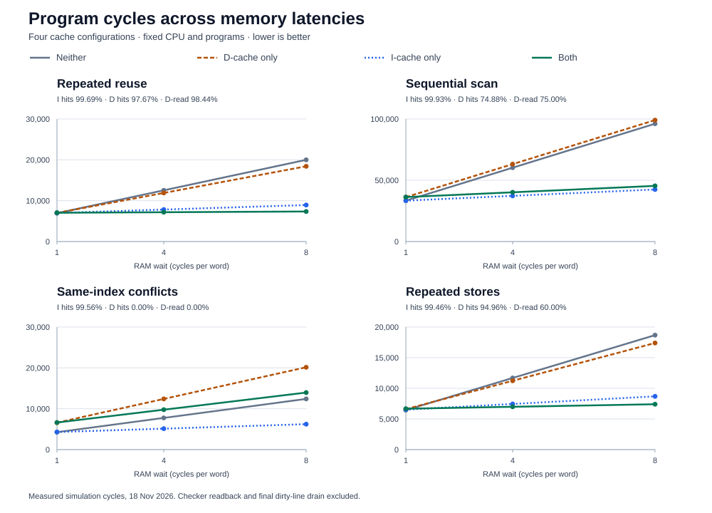

# Verified Instruction and Data Cache Subsystem for PicoRV32

A SystemVerilog cache subsystem integrated with the PicoRV32 RISC-V CPU,
with standalone verification and measured comparisons across four cache
configurations.

**Status:** RTL and simulation scope complete. **52/52 processor configurations
pass.** The standalone D-cache regression also passes all 16 cases and its
442 defined functional coverage bins.

## Design

| Feature | Implementation |
| --- | --- |
| CPU | Pinned third-party PicoRV32, RV32I configuration |
| Instruction cache | 4 KiB, direct mapped, read only |
| Data cache | 4 KiB, direct mapped, write-back/write-allocate |
| Line size | 16 bytes: four 32-bit words |
| Interfaces | 32-bit native valid/ready, byte-addressed |
| Stores | Four byte-enable strobes |
| Memory | Shared 32-bit simulation RAM port |
| Configuration | Independent I-cache and D-cache enable/bypass parameters |
| Reset | Synchronous, active low |

~~~mermaid
flowchart LR
    CPU["PicoRV32 CPU RV32I native memory port"] --> ROUTE["Cache wrapper instruction/data routing"]
    ROUTE --> IC["I-cache 4 KiB · read only"]
    ROUTE --> DC["D-cache 4 KiB · write-back"]
    IC --> MUX["Shared RAM selection"]
    DC --> MUX
    ROUTE -. "independent bypass paths" .-> MUX
    MUX <--> RAM["32-bit RAM configurable wait"]
~~~

Arrows identify request paths; ready/read-data responses return along the
selected path. The CPU holds one request at a time. The caches share RAM;
this integration does not add simultaneous instruction/data requests.

See the [architecture](ARCHITECTURE.md) for interfaces, address fields and
controller state diagrams, and the [specification](SPEC.md) for the contract.

## Measured results

Four workloads run with neither cache, D-cache only, I-cache only and both,
at RAM waits of 1, 4 and 8 cycles. Four additional smoke configurations
bring the total to **52 passing processor cases**.

Program cycles at **RAM wait 8**, lower is better:

| Workload | Neither | D-cache only | I-cache only | Both | Both vs neither: fewer cycles |
| --- | ---: | ---: | ---: | ---: | ---: |
| Repeated reuse | 20,002 | 18,418 | 8,938 | 7,354 | 63.23% |
| Sequential scan | 96,142 | 99,082 | 42,490 | 45,430 | 52.75% |
| Same-index conflicts | 12,408 | 20,148 | 6,221 | 13,961 | -12.52% |
| Repeated stores | 18,680 | 17,396 | 8,686 | 7,402 | 60.37% |

The I-cache reduces repeated instruction fetches from RAM. The D-cache helps
data reuse, while same-index accesses can thrash it. A sequential scan can
have 75% data-read hits yet save no input RAM words: each miss refills four
words, each with the full RAM wait. Controller overhead and refill cost
therefore matter alongside hit rate.

Read the [full results and hit rates](verification/CACHE_MODES_REPORT.md),
[machine-readable measurements](verification/results/cache_modes/results.json)
and [verification summary](verification/README.md).

## Quick start

Requires **Questa 2024.1** (the validated version) and **Python 3.9+**.
Standalone D-cache tests additionally use precompiled UVM 1.1d and matching
headers. Run from the repository root, with Questa on PATH:

~~~powershell
# Reuse workload, both caches, RAM wait 8.
vsim -c -do 'do sim/run_processor.do reuse 1 8 1; quit -code 0'

# Fresh 52-case matrix and saved-log audit.
vsim -c -do 'do sim/benchmark_cache_modes.do; quit -code 0'
~~~

Require `PROCESSOR_PROGRAM_PASS` for the first command and
`CACHE_MODES_BENCHMARK_PASS: configurations=52` for the second.

The individual-run arguments are
`PROGRAM USE_DCACHE RAM_WAIT_CYCLES USE_ICACHE`.
Defaults are `smoke 1 1 0`. The reuse command above takes **7,354 program
cycles**. See [all run instructions](sim/README.md) for tool paths, standalone
suites and output definitions.

## Repository layout

| Path | Contents |
| --- | --- |
| `rtl/` | I-cache, D-cache, wrapper and processor top |
| `tb/` | UVM D-cache environment and plain SV integration/I-cache tests |
| `programs/` | Workload assembly and checked hexadecimal instruction images |
| `sim/` | Questa runners and tool discovery |
| `verification/` | Audits, reports, test plan and curated results |
| `diagrams/` | Architecture and measured-performance figures |
| `third_party/picorv32/` | Pinned CPU source, provenance and ISC license |
| `tools/` | Figure generation and clean source packaging |

Generated libraries, waves, transcripts and local learning snapshots are
excluded by `.gitignore`. To produce a clean source archive:

~~~powershell
python tools/package_repository.py
~~~

The archive is written under `dist/`. Packaging also checks local Markdown
links, required files, measured-result totals and the current validated source
fingerprints. Formatting and line endings are defined in .editorconfig and
.gitattributes; upstream CPU bytes and checked program images are preserved.

## Scope and limitations

This is a single-clock, blocking, direct-mapped design with one CPU request
in flight. Program memory is fixed during execution; FENCE.I, self-modifying
code, coherence, MMIO and memory errors are outside this version.

Reset invalidates cache contents; dirty cache-only data may be lost. There
is no whole-cache flush. Completion timing stops at the CPU marker handshake
and excludes testbench readback and a final dirty-line drain.

Reported improvements are **simulation cycle reductions for these workloads**.
FPGA area, achieved clock frequency and power have not been measured.

## Authorship and licensing

Developed by **Muhammad Hashir Aslam** through guided implementation and
review. [ATTRIBUTION.md](ATTRIBUTION.md) distinguishes learner work, mentor
assistance and third-party code.

PicoRV32 is existing CPU IP, retained at a pinned revision under its ISC
license. No additional license has been selected for project-authored files.
